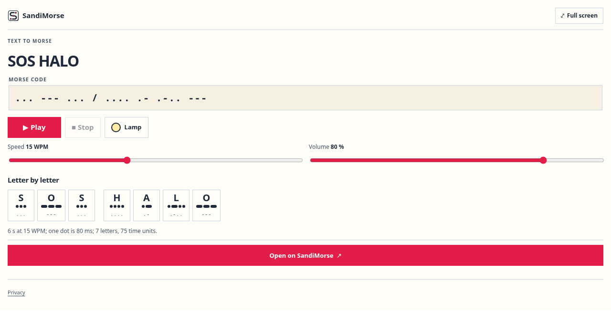
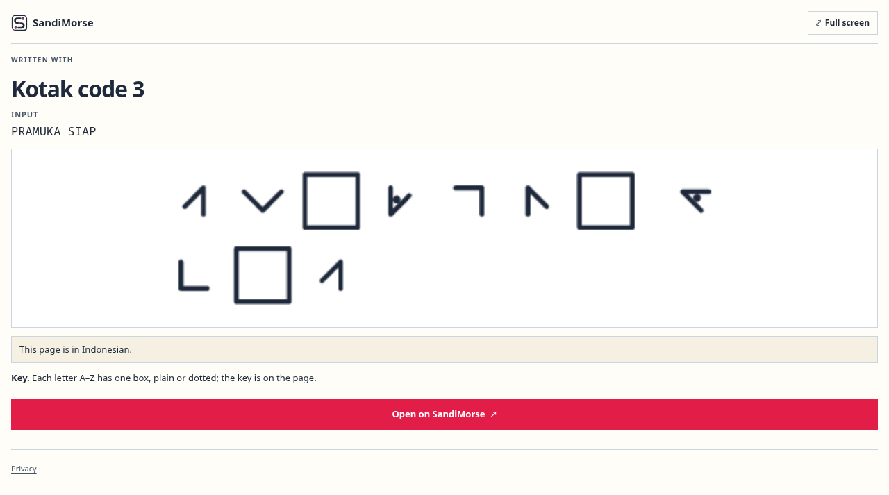
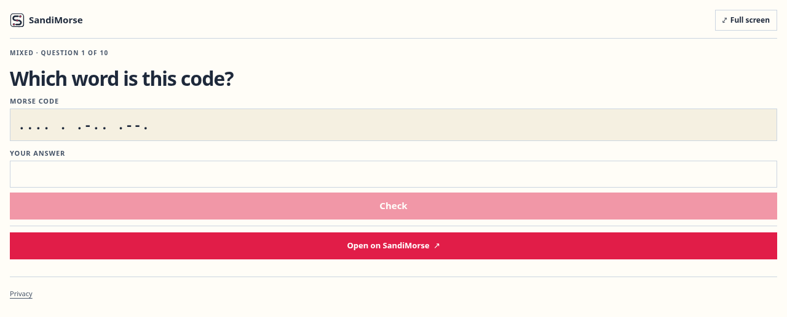

# SandiMorse MCP server


SandiMorse is a hosted, read-only [Model Context Protocol](https://modelcontextprotocol.io) server for Morse code and the Indonesian Pramuka (scout) codes. An AI assistant can use it to translate text to Morse and back, look up a letter with ways to remember it, write or read a message in a scout code and run Morse practice rounds. In hosts that support MCP Apps (ChatGPT, Claude) it also shows an interactive widget with a sound player and a lamp that blinks the code.

- Website: https://sandimorse.com
- MCP endpoint: `https://sandimorse.com/api/mcp` (Streamable HTTP, no sign-in)
- Documentation: https://sandimorse.com/app
- Official MCP Registry name: `com.sandimorse/sandimorse`

This repository holds the public server description, icons and connection instructions. The server itself is hosted at sandimorse.com, so there is nothing to install or run locally.

## Tools

All tools are read-only.

| Tool | What it does |
|---|---|
| `translate_morse` | Text to Morse and Morse to text, with a letter-by-letter breakdown, signal timing, a sound player and a lamp |
| `morse_chart` | The Morse chart (A to Z, 0 to 9, punctuation) or one character with its code, dot and dash counts and memory tips |
| `encode_scout_code` | A message written in one of 16 scout codes; kotak, rumput and semaphore come back as pictures |
| `decode_scout_code` | A coded message read back to text in 11 of the codes, with the key used |
| `morse_practice` | Ten Morse practice questions with answers: letter to code, code to letter, words, listening or mixed |
| `list_codes` | The 17 codes with name, what each is, its key, an example and a link to its page |

- Answers follow the `language` argument, Indonesian (`id`, default) or English (`en`).
- Drawn codes (kotak 1 to 3, rumput, semaphore) can be written but not read back from text.

## Connect

### ChatGPT and Claude

Add a custom connector with the URL `https://sandimorse.com/api/mcp` and choose no authentication.

### Claude Desktop, Cursor and other MCP clients

```json
{
  "mcpServers": {
    "sandimorse": {
      "url": "https://sandimorse.com/api/mcp"
    }
  }
}
```

Clients that only launch local servers can connect through a bridge such as [`mcp-remote`](https://www.npmjs.com/package/mcp-remote):

```json
{
  "mcpServers": {
    "sandimorse": {
      "command": "npx",
      "args": ["-y", "mcp-remote", "https://sandimorse.com/api/mcp"]
    }
  }
}
```

## Try asking

- "Translate SOS HALO into Morse code."
- "Show me the Morse code for K and how to remember it."
- "Write PRAMUKA SIAP in Kotak 3."
- "Decode this ROT13 message: CENZHXN"
- "Terjemahkan halo ke sandi morse."

## On the website

- [Morse code translator (English)](https://sandimorse.com/en/)
- [Kode morse (Indonesian)](https://sandimorse.com/)

## Screenshots

| Translate | Kotak code | Practice |
|---|---|---|
|  |  |  |

## Privacy and support

- Privacy: https://sandimorse.com/en/privacy/
- Terms: https://sandimorse.com/en/terms/
- Support: https://sandimorse.com/en/contact/ or abishop1933@gmail.com

SandiMorse has no accounts. The text sent from the chat is used to compute the answer and is not stored by SandiMorse; the hosting provider keeps standard request logs for a short time.

To report a problem, open an issue in this repository or write to abishop1933@gmail.com.

## License

The text and icons in this repository are released under the [MIT License](LICENSE). The SandiMorse website, its content and brand are not covered by it.
